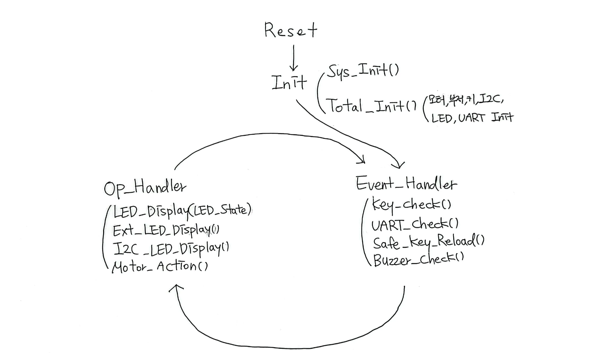

# 온디바이스AISW개발2기_5팀(고현호,한재원,윤유진,박시영)_상위설계서

# KDT-Motor-Project 상위설계서 (High-Level Design)

| 항목 | 내용 |
| --- | --- |
| **프로젝트명** | KDT-Motor-Project (1주차 최종 프로젝트) |
| **타깃 MCU** | STM32F411RE (Nucleo-F411RE) |
| **팀 구성** | 팀장 고현호
팀원 윤유진, 박시영, 한재원 |
| **문서 버전** | v2.1 기준 |

## 1. 프로젝트 개요

### 1.1 목적

Polling방식으로 동작하던 기존 프로젝트를 인터럽트 기반으로 전환.
수업시간에 배운 내용을 최대한 활용하는 방향으로 진행함.

### 1.2 적용 기술

- **폴링 (Polling):** 메인 루프 기반 세이프키 해제 안정화 감시(`Safe_Key_Reload`), 외부 LED 3종 및 I2C 8-LED 속도 게이지 상태 갱신
- **외부 인터럽트 (EXTI):** 제어 버튼(`PC13`, `EXTI15_10`) 양 엣지 감지 및 세이프키(`PB5`, `EXTI9_5`) 최우선 비상정지(E-Stop)
- **타이머 인터럽트 (TIM4):** 버튼 2초 길게 누름 시간 측정 및 2초 도달 알림음 트리거
- **UART 통신 (USART2):** PC 키보드(Tera Term) 수신 인터럽트 기반 방향·정지·속도 및 시크릿 코드 명령 처리
- **PWM (TIM2, TIM3):** `TIM2` CH1/CH2 기반 DC 모터 정·역회전 및 속도 제어 (듀티비 50%~100%), `TIM3` CH2 기반 피에조 부저 주파수 출력
- **I2C 통신 (I2C1):** SC16IS752 GPIO 확장기를 통한 8-LED 모터 속도 게이지 표시

## 2. 하드웨어 구성 및 자원 할당

### 2.1 시스템 기본 사양

- **MCU 및 클럭:** STM32F411RE (ARM Cortex-M4), SYSCLK 96 MHz
- **타이머 자원**
    - `TIM2` (모터 PWM): `TIM2_TICK = 1 µs` (1 MHz), `TIM2_MAX = 49` (50카운트, 20 kHz, 업카운팅 PWM Mode 1)
    - `TIM3` (부저 PWM): 1 µs/틱 (1 MHz), 업카운팅 PWM Mode 1 (가변 주파수, 50% 듀티)
    - `TIM4` (2초 타이머): `TIM4_TICK = 50 µs` (20 kHz), `TIM4_PLS_OF_2s = 40000` (2.0초 만료 인터럽트)
- **사용 소자 (기능별 구성)**
    - **제어 보드:** STM32F411RE (Nucleo-F411RE)
    - **모터 구동부:** DC 모터, L293 H-브릿지 내장 모터 드라이버 칩셋
    - **입력 소자:** 택트 스위치 2개 (제어 버튼 확장 · 세이프키/비상정지), 보드 내장 버튼(`PC13`)
    - **상태 표시부 (LED):** 외부 LED 3개 (초록 · 파랑 · 노랑 각 1개), I2C용 실습 LED 보드 1개 (SC16IS752 8-LED 모듈), 보드 내장 LED(`PA5`)
    - **음향 출력부:** 피에조 부저 1개

### 2.2 핀 매핑 (Pinout)

> 실제 배선에 사용하는 헤더 핀만 표기하며, 보드 내부 연결(ST-Link UART, 내장 LED 등)로 인해 외부 헤더 핀을 사용하지 않는 항목은 헤더 핀 칸을 X로 표시함.
> 

| 구분 | MCU 핀 | 헤더 핀 | 설정 모드 | 용도 및 동작 |
| --- | --- | --- | --- | --- |
| **모터 핀1** | `PA0` | `A0` | AF1 (`TIM2_CH1`) | L293 H-브릿지 PWM 출력 |
| **모터 핀2** | `PA1` | `A1` | AF1 (`TIM2_CH2`) | L293 H-브릿지 PWM 출력 |
| **UART** | `PA2`, `PA3` | x | AF7 (`USART2_TX/RX`) | PC 키보드 명령 수신 |
| **내장 LED** | `PA5` | x | GP Output (Push-Pull) | 보드 내장 LED (제어 버튼 짧은 누름 시 토글) |
| **제어 버튼 (택트 스위치 1)** | `PC13` | `CN7-23` | Input / `EXTI13` | 2초↑ 전원 ON/OFF, 2초↓ 방향 전환 (보드 내장 B1 및 외부 택트 스위치 연동) |
| **세이프키 / 비상정지 (택트 스위치 2)** | `PB5` | `D4` | Input (외부 10 kΩ 풀다운) / `EXTI5` | 기동 안전 조건(HIGH) 및 운전 중 최우선 비상정지 |
| **외부 LED (초록)** | `PA9` | `D8` | GP Output (Push-Pull) | 정회전(CW) 동작 중 점등 |
| **외부 LED (노랑)** | `PC7` | `D9` | GP Output (Push-Pull) | 역회전(CCW) 동작 중 점등 |
| **외부 LED (파랑)** | `PA6` | `D12` | GP Output (Push-Pull) | 세이프키(`PB5`) 눌림 중 점등, 떼면 (`GPIOA->ODR` 6번 비트) |
| **피에조 부저** | `PA7` | `D11` | AF2 (`TIM3_CH2`) | 2초 도달 알림음 및 비상정지 경고음 |
| **I2C 실습 LED 보드**
SC16IS752 | `PB6`, `PB7` | `D10`, `CN7-21` | AF4 (`I2C1_SCL/SDA`) | 8-LED 속도 게이지 (1~8단 게이지, 9단 교대 점멸) |

## 3. 시스템 아키텍처 및 상태 전이

### 3.1 계층 구조 및 상태 전이도 (STATE Diagram)

### 3.2 계층별 역할 및 데이터 전달 흐름

| 계층 | 주요 구성 요소 | 역할 |
| --- | --- | --- |
| `exception.c` | `EXTI15_10_IRQHandler`, `TIM4_IRQHandler`, `USART2_IRQHandler`, `EXTI9_5_IRQHandler` | 내부 스위치의 방향 전환 및 전원 제어
2초 만료 시 타임아웃
키보드 입력 시 데이터 전달
비상 정지 |
| `Event_Handler` | `Key_Check`, `Safe_Key_Reload`, `Uart_Check`, `Buzzer_Check` | 내부 키 입력에 따른 모터 회전 방향 설정
외부 키 입력 채터링 방지
UART 입력에 따른 모터 회전 방향, 속도 설정
비상 정지 시 부저 울림 |
| `Op_Handler` | `Motor_Stop/Cw/CCw`, `Motor_Set_CCR`, `LED_Display`, `Ext_LED_Display`, `I2C_LED_Display` | 모터 회전 방향 제어
모터 회전 속도 계산
내부 LED 제어
회전 방향에 따른 외부 LED 제어
속도 단계에 따른 보드 LED 제어 |

## 4. 전역 변수 및 데이터 명세

| 변수명 | 자료형 | 초기값 | 상태 코드 및 역할 |
| --- | --- | --- | --- |
| `Motor_State` | `volatile int` | `0` | `0`: STOP, `1`: CW(정회전), `2`: CCW(역회전) |
| `Motor_Speed` | `volatile int` | `1` | `1`~`9` 속도 단계 (PWM 듀티비 50%~100%) |
| `LED_State` | `int` | `0` | `0`: 내장 LED(`PA5`) OFF, `1`: ON |
| `Key_Pressed` | `volatile int` | `0` | `PC13` 버튼 눌림 감지 플래그 (`0`/`1`) |
| `Key_Released` | `volatile int` | `0` | `PC13` 버튼 뗌 감지 플래그 (`0`/`1`) |
| `TIM4_Expired` | `volatile int` | `0` | `TIM4` 2초 만료 기록 플래그 (`0`/`1`) |
| `Key_Long_Pressed` | `volatile int` | `0` | 버튼 뗌 시 확정된 2초 이상 누름 여부 (`0`/`1`) |
| `Uart_Pressed` | `volatile int` | `0` | UART 유효 수신 플래그 (`0`/`1`) |
| `Uart_Data` | `volatile unsigned char` | `0` | 수신 문자 (`'F'`/`'f'`, `'S'`/`'s'`, `'R'`/`'r'`, `'1'`~`'9'`, 및 키보드 입력) |
| `Safe_Key_Wait_Release` | `volatile int` | `0` | 기동 직후 세이프키 채터링 차단·`EXTI5` 재무장 대기 |
| `Estop_Buzzer` | `volatile int` | `0` | 비상정지 경고음 출력 요청 플래그 (`0`/`1`) |
| `Secret_Key` | `volatile int` | `0` | 시크릿 코드(`"nintendo"`) 입력 활성화 상태 플래그 |

## 5. 모듈별 상위 설계

### 5.1 메인 및 초기화 모듈 (`main.c` / `peripheral.c`)

- **`void Main(void)`**
    - `Sys_Init(115200)`과 `Total_Init()`을 호출하여 초기화
    - 무한 루프(`for(;;)`)에서 `Event_Handler()`와 `Op_Handler()`를 반복 실행
- **`static void Sys_Init(int baud)`**
    - 시스템 클럭 96 MHz 설정(`Clock_Init`)
    - `USART2` baud rate 설정(`Uart2_Init`)
    - 보드 내장 LED(`PA5`) 초기화(`LED_Init`)
- **`static void Total_Init(void)`**
    - 모터·안전키 입력·출력 초기화: `Motor_Init()`, `Safe_Key_Init()`, `Ext_LED_Init()`, `Buzzer_Init()`
    - 타이머 및 인터럽트 초기화: `Key_Timer_Init()`(TIM4), `Motor_Timer_Init()`(TIM2)`, Buzzer_Init()` (TIM3), `Key_ISR_Enable(1)`, `Uart2_RX_Interrupt_Enable(1)`
    - I2C 속도 게이지 보드 초기화: `I2C1_SC16IS752_Init()`, `I2C1_SC16IS752_Config_GPIO(0xFF)`, `I2C1_SC16IS752_Write_GPIO(0xFF)`

### 5.2 인터럽트 서비스 루틴 모듈 (`exception.c`)

- **`void EXTI15_10_IRQHandler(void)`**
    - 판정 간섭 방지를 위해 진입 시 `TIM4` 인터럽트를 일시 차단
    - `PC13` Falling Edge(눌림): `TIM4_Expired = 0` 초기화 후 `TIM4->EGR`로 카운터를 리셋해 2초 측정을 시작하고 `Key_Pressed = 1` 설정
    - `PC13` Rising Edge(뗌): `TIM4_Expired` 또는 `TIM4->SR` UIF를 검사해 `Key_Long_Pressed`를 확정한 뒤 `Key_Released = 1` 설정
- **`void TIM4_IRQHandler(void)`**
    - 2초 경과 시 `TIM4->SR` UIF 비트를 해제하고 `TIM4_Expired = 1` 기록
    - `Buzzer_On(2000)`을 호출해 사용자에게 2초 도달 알림음 출력
- **`void USART2_IRQHandler(void)`**
    - `USART2->DR`을 읽어 `Uart_Data`에 저장
    - 모터 동작 중(`TIM2->CCR1 ^ TIM2->CCR2`)일 때 `Uart_Pressed = 1`을 설정해 메인 루프에 전달
- **`void EXTI9_5_IRQHandler(void)`**
    - 최우선순위(0) 인터럽트로 동작하며 `Safe_Key_Wait_Release == 0` 및 모터가 동작 중인지(`Motor_State != 0`) 조건 확인
    - 짧은 채터링 노이즈 확인 후 즉시 `TIM2->CCR1 = 0`, `TIM2->CCR2 = 0`, `Motor_State = 0`으로 모터 차단
    - `Estop_Buzzer = 1`을 설정해 메인 루프에 비상 정지 경고음 출력 요청

### 5.3 이벤트 처리 모듈 (`Event_Handler`)

- **`static void Key_Check(void)`**
    - 경쟁 상태 방지를 위해 처리 중 `EXTI15_10` 인터럽트를 일시 마스킹
    - `Key_Released` 감지 시 `Buzzer_Off()`로 2초 알림음 종료
    - 길게 누름(`Key_Long_Pressed == 1`): `STOP` 상태 및 세이프키(`PB5`) HIGH 조건일 때 `EXTI5` 일시 잠금·`Safe_Key_Wait_Release = 1`·`Motor_State = CW`로 기동, 동작 중에는 세이프키와 무관하게 `STOP`
    - 짧게 누름(`Key_Long_Pressed == 0`): `LED_State`를 반전하고 동작 중 `CW ↔︎ CCW` 방향 전환
- **`static void Safe_Key_Reload(void)`**
    - 기동 직후 세이프키에서 손을 뗄 때 발생하는 채터링 오동작 차단
    - 폴링 방식으로 `PB5`가 안정적인 LOW 상태를 연속 유지(`cnt > 300000`)하면 펜딩 비트를 정리하고 `EXTI5` 비상정지 인터럽트 재활성화
- **`static void Uart_Check(void)`**
    - `Uart_Pressed` 확인 후 플래그 클리어
    - 수신 문자(`Uart_Data`)에 따라 `'1'`~`'9'`는 `Motor_Speed` 갱신, `'S'`/`'s'`는 `STOP`, `'F'`/`'f'`는 `CW`, `'R'`/`'r'`은 `CCW`로 상태 변경
    - `Secret_Code`(`"nintendo"`) 순차 입력 매칭 판별
- **`static void Buzzer_Check(void)`**
    - `Estop_Buzzer` 플래그 확인 시 플래그 클리어
    - `TIM3_CH2`(`PA7`)를 통해 800 Hz 비상 경고음 3회 출력

### 5.4 구동 출력 모듈 (`Op_Handler`)

- **`void Op_Handler(void)`**
    - 내장 LED(`LED_Display`), 외부 LED 3종(`Ext_LED_Display`), I2C 8-LED 속도 게이지(`I2C_LED_Display`) 갱신
    - `Motor_State`에 따라 모터 구동 분기(`Motor_Stop` / `Motor_Cw` / `Motor_CCw`)
    - `CW ↔︎ CCW` 직접 전환 시 역기전력 및 L293 H-브릿지 보호를 위해 `Motor_Stop()` 선행 호출 및 지연 구간 적용
- **`Ext_LED_Display()`**
    - 초록 LED(`PA9`): 정회전(`CW`) 시 ON, 그 외 OFF
    - 파랑 LED(`PC7`): 역회전(`CCW`) 시 ON, 그 외 OFF
    - 노랑 LED(`PA6`): 세이프키(`PB5`) 눌림 동안 ON, 뗌 시 OFF
- **모터 PWM 제어 함수 (`Motor_Set_CCR`, `Motor_Stop`, `Motor_Cw`, `Motor_CCw`)**
    - `Motor_Set_CCR()`: `25 + 25 * (Motor_Speed - 1) / 8` 수식으로 1~9단을 CCR 25~50(듀티비 50%~100%)으로 선형 변환
    - `Motor_Stop()`: `TIM2->CCR1 = 0`, `TIM2->CCR2 = 0`으로 완전 정지
    - `Motor_Cw()` / `Motor_CCw()`: 활성 채널에 계산된 CCR값을 기록하고 반대 채널은 0으로 유지
- **`I2C_LED_Display()` (`i2c.c` 연동)**
    - 출력 패턴 변경 시에만 `I2C1_SC16IS752_Write_GPIO()`를 호출해 메인 루프 지연 최소화

### 5.5 시크릿 코드(`"nintendo"`) 활성화 동작 명세

(PC 편집 입력란 — UART2로 `"nintendo"` 입력 후 `Secret_Key` 활성화 시 마리오 테마곡 재생

## 6. 속도 단계별 PWM 및 I2C LED 매핑 명세

`TIM2->ARR = 49` (총 50틱, 20 kHz, 업카운팅 PWM Mode 1)

| 입력 키 (`Motor_Speed`) | `TIM2->CCR` 값 | PWM 듀티비 | I2C 8-LED 패턴 (Hex) | 시각적 표시 상태 |
| --- | --- | --- | --- | --- |
| `'S'` / `'s'` (정지) | `0` | 0% | `0xFF` | 전체 소등 |
| `'1'` | `25` | 50% | `0x7F` | LED 7 (1개 점등) |
| `'2'` | `28` | 56% | `0x3F` | LED 7~6 (2개 점등) |
| `'3'` | `31` | 62% | `0x1F` | LED 7~5 (3개 점등) |
| `'4'` | `34` | 68% | `0x0F` | LED 7~4 (4개 점등) |
| `'5'` | `37` | 74% | `0x07` | LED 7~3 (5개 점등) |
| `'6'` | `40` | 80% | `0x03` | LED 7~2 (6개 점등) |
| `'7'` | `43` | 86% | `0x01` | LED 7~1 (7개 점등) |
| `'8'` | `46` | 92% | `0x00` | LED 7~0 (8개 전체 점등) |
| `'9'` | `50` | 100% | `0xAA` ↔︎ `0x55` | 짝수·홀수 교대 점멸 
(최고속 경고) |

## 7. 역할 분담 (R&R)

| 직책 | 이름 | 담당 파트 | 주요 구현 및 검증 범위 |
| --- | --- | --- | --- |
| **팀장** | 고현호 | MOTOR, BUZZER, TIM3 | 전체 코드 점검 및 병합, 모터 단계 제어, 부저 기능 |
| **팀원** | 윤유진 | UART, ISR | UART 키보드 입력 제어 |
| **팀원** | 박시영 | UART, TIM4 | 내부KEY 2초 기준 ON/OFF, UART 시크릿 코드 |
| **팀원** | 한재원 | MOTOR, I2C, TIM2 | 모터 기능 구현, I2C 보드, LED |
| **팀 전원** | 디버깅, 시스템 아키텍처 설계, 상위설계서 작성 및 모듈 간 인터페이스·통합 관리 |  |  |

## 8. 버전 개정이력 (Revision History)

| 버전 | 개정일자 | 주요 변경 내용 |
| --- | --- | --- |
| **v1.0** | 11월 20일 | PC13 버튼(`EXTI13` + `TIM4`) 기반 전원 ON/OFF(2초↑) 및 정·역회전 전환(2초↓), 
UART2 입력(`F`/`f`, `S`/`s`, `R`/`r`, `1`~`9`)을 통한 방향·정지 및 TIM2 PWM 속도 제어(50%~100%) 구현 |
| **v1.1** | 11월 21일 | LED와 피에조 부저 추가 |
| **v1.2** | 11월 21일 | `Safety_key` 추가 |
| **v1.3** | 11월 21일 | I2C 추가 및 PC13 외부키 추가 |
| **v2.0** | 11월 22일 | `main.c`에 몰아둔 코드를 `peripheral.c`로 분리·수정 |
| **v2.1** | 11월 22일 | 시크릿 코드 및 피에조 부저 song note 추가 |